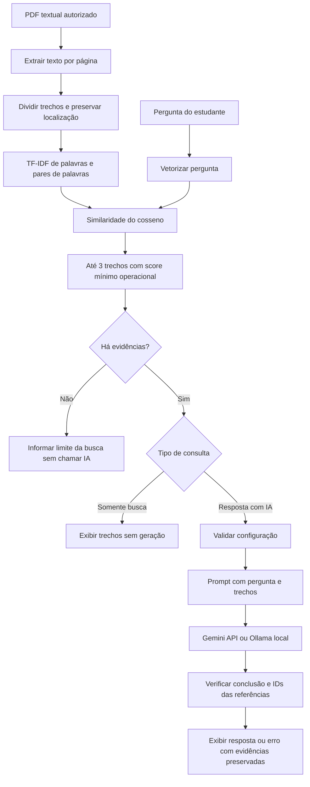
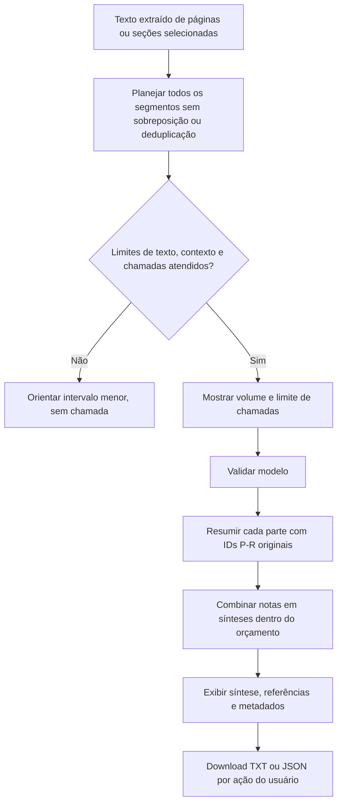

# Arquitetura do EstudaPDF

## Responsabilidades

- `document.py`: leitura local e chunking por página; páginas sem texto não
  mudam a numeração das seguintes.
- `retrieval.py`: representação TF-IDF e recuperação lexical ordenada.
- `prompts.py`: instruções e contexto serializado em JSON, versão `estudapdf-rag-v1`.
- `providers.py`: integração REST, autenticação, timeout, erros e respostas completas.
- `service.py`: orquestração, modo de busca, referências e registro exportável.
- `summary.py`: plano de leitura integral do texto selecionado, resumo por partes
  e sínteses hierárquicas, com referências P-R e limites.
- `demo.py`: conteúdo educativo de demonstração, explicitamente identificado.
- `app.py`: ponto de entrada do Streamlit.
- `settings.py`: leitura privada do `.env` a cada reexecução, sem alterar o
  ambiente; variáveis explícitas do processo têm prioridade. A chave não tem
  campo de entrada ou exibição na interface e não é incluída no pacote.
- `frontend.py`: workspace, envio de PDF, biblioteca de materiais da sessão, perguntas e evidências.
- `ui.py` e `assets/styles.css`: componentes visuais locais, ícones e estilos
  responsivos. Dados externos são escapados; respostas e trechos permanecem
  em texto simples, sem interpretar conteúdo do modelo como HTML ou Markdown.

O aplicativo não usa persistência documental, conta de usuário, banco vetorial
ou histórico de conversa. Cada pergunta é independente. Os pesos TF-IDF são
ajustados apenas ao documento; isso não treina o modelo de linguagem.

## Escolhas e limites

A recuperação lexical evita instalar outro modelo e facilita inspecionar o
processo no prazo do projeto. Em contrapartida, não representa significado
como embeddings semânticos e depende de coincidência de vocabulário.

Os trechos são de até 1.100 caracteres, com sobreposição de até 180 por página.
Até três são selecionados, com score mínimo de 0,05. Esses valores são escolhas
de engenharia para o protótipo, não parâmetros cientificamente otimizados.

JSON e instruções explícitas ajudam a separar contexto de comandos, mas não
garantem resistência a injeção de prompt. A checagem de referências detecta
IDs ausentes no formato esperado, não verifica apoio semântico das afirmações.

## Fluxo de resumo do material

Este fluxo não faz busca top 3. Todos os segmentos selecionados são enviados
às etapas de mapa; a síntese necessariamente comprime o conteúdo e pode omitir
ideias. A verificação de IDs valida identidade, não apoio semântico das afirmações.

O preflight limita a 60 mil caracteres e até 20 chamadas, com teto conservador
de `2 × número de blocos − 1`. Prompts de leitura (mapa) têm orçamento de 6 mil
bytes UTF-8 e prompts de síntese, 16 mil. Notas de bloco e intermediárias são
limitadas a 3 mil bytes e a visão geral a 6 mil; saídas maiores são rejeitadas
sem truncamento. As notas de cada bloco são preservadas e exibidas como
"resumo por partes" junto à visão geral. Erros temporários do provedor (5xx)
são repetidos até três vezes e um tempo esgotado, uma vez.
Falhas interrompem a operação sem apresentar parciais como resumo completo.

Uma saída final sem IDs pode ser exibida com aviso explícito e sem atribuição
automática de citações. O painel passa a mostrar o texto processado como entrada,
não como comprovação das afirmações. O aviso acompanha o TXT e o JSON. Notas
intermediárias sem referências continuam sendo rejeitadas, assim como referências
desconhecidas, recusa, texto vazio ou saída acima do orçamento. Um modelo que
nunca cita pode continuar falhando em resumos com várias etapas.

## Fluxo de dados

PDF e índice permanecem no estado da sessão, sem cache global. Nas perguntas, Gemini recebe
prompt, pergunta e trechos somente após ação do usuário na interface.
Ollama recebe esses dados no serviço local. Exportar o registro JSON é uma
ação explícita do usuário e pode revelar conteúdo documental; revisar antes
de compartilhar. A chave não é incluída nesse registro.

No resumo, Gemini recebe todo o texto extraído do intervalo selecionado em
partes, quando o usuário aciona o resumo, sem confirmação adicional.
Ollama recebe o mesmo conteúdo no serviço local. Exportar o resumo ou registro
é uma ação explícita, e os arquivos também podem conter conteúdo documental.
