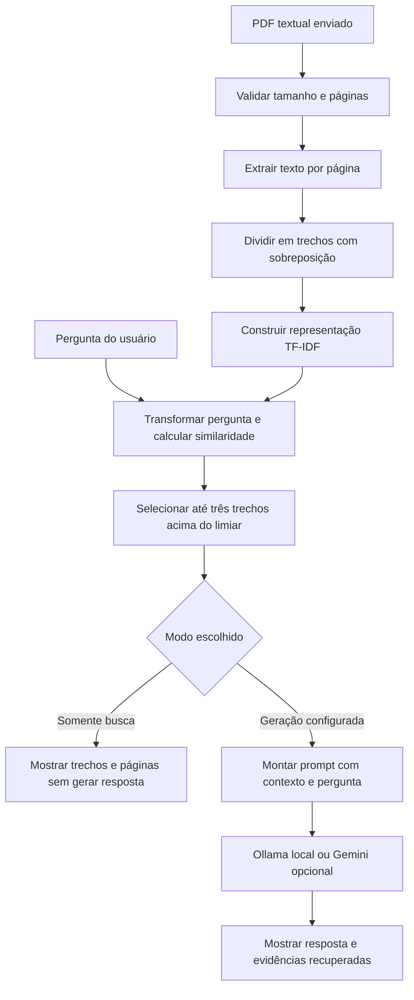

# EstudaPDF: assistente de estudos com geração aumentada por recuperação

**Projeto Prático — IA Generativa**  
**Entrega prevista:** 19 de novembro de 2026  
**Grupo:** seis integrantes — preencher nomes e participação efetiva  
**Versão:** rascunho de desenvolvimento, atualizado em 17/11/2026

> Este relatório permanece um rascunho. A implementação inicial foi exercitada
> com testes automatizados, busca na demo interna e duas execuções reais da
> mesma pergunta no Ollama, registradas na seção 5. A avaliação foi assistida por IA, não
> revisada por humanos. Esses resultados não equivalem a validação independente
> ou avaliação de PDF real. Revisão humana e teste com PDF continuam pendentes.
> Em 17/11, o resumo global foi implementado e a suíte chegou a 61 testes
> aprovados. Após dois pilotos rejeitados por ausência de IDs, um terceiro
> resumo real foi concluído em 99,018 s, com aviso de falta de referências.
> Sua revisão assistida por IA identificou uma ambiguidade conceitual; não é
> aprovação humana ou validação de qualidade geral. O caso usa a demo textual.

## 1. Descrição da aplicação

### 1.1 Problema identificado

Estudantes consultam apostilas e outros materiais extensos para localizar
definições, comparar conceitos e compreender processos. Uma busca por palavras
ajuda a encontrar passagens, mas exige que o leitor organize as informações.
Uma resposta produzida apenas pelo conhecimento geral de um modelo pode
introduzir afirmações que não aparecem no material da disciplina.

O EstudaPDF propõe unir recuperação de passagens e geração de uma explicação.
O usuário fornece um PDF textual e faz uma pergunta. O aplicativo recupera
trechos relacionados à pergunta e, quando um provedor está configurado, envia
esses trechos a um modelo para apoiar a resposta. As páginas e os trechos
recuperados ficam disponíveis para conferência pelo usuário.

Um segundo fluxo, solicitado e implementado em 17/11, permite resumir todo
o texto extraído de um intervalo de páginas escolhido. Ele é distinto da
resposta a uma pergunta: não usa apenas os três trechos mais semelhantes.
O resumo global trabalha com o conjunto textual selecionado por etapas de mapa
e síntese. “Global” refere-se ao intervalo selecionado, não necessariamente ao
PDF inteiro nem ao conteúdo visual que a extração não capturou.

### 1.2 Público e objetivo

O público inicial é formado por estudantes que consultam materiais em português.
O objetivo do protótipo é facilitar a navegação e a compreensão desses materiais,
mantendo as evidências acessíveis. O sistema não substitui a leitura crítica
nem garante que toda resposta esteja correta.

### 1.3 Escopo e limites de entrada

A versão implementada aceita um PDF por vez, com limite de 15 MB e 150 páginas.
O documento precisa conter texto extraível. Digitalizações sem camada textual
exigem OCR, recurso que não faz parte deste escopo. A formatação original,
tabelas e equações podem não ser preservadas corretamente na extração.

Não está prevista busca na internet ou em documentos que o usuário não tenha
fornecido. Não é necessário coletar ou rotular um conjunto de treinamento. O
documento fornecido é a base de conhecimento consultada naquela sessão.

## 2. Ferramentas utilizadas e funções

As versões efetivamente instaladas e o identificador do modelo precisam ser
registrados a partir do ambiente utilizado na demonstração.

| Ferramenta | Função no projeto | Informação a confirmar |
| --- | --- | --- |
| Python | Implementação do processamento e integração | Versão executada |
| Streamlit | Interface local para documento, pergunta e resultados | Versão instalada |
| pypdf | Extração do texto e preservação da referência à página | Versão instalada |
| scikit-learn | TF-IDF e similaridade do cosseno | Versão instalada |
| Ollama, via API local | Provedor principal, com geração real a partir dos trechos | qwen2.5:3b respondeu uma pergunta em 133,11 s; revisão humana pendente |
| Gemini API, via REST | Alternativa de provedor externo | Sem chave; nenhuma chamada real testada |
| Google AI Studio, opcional | Exploração de prompts se Gemini for utilizado | Não registrar como utilizado sem execução |
| Codex | Assistência no código, documentação e planejamento | Registrar revisões e decisões humanas |

Ollama passou a ser o provedor principal após a localização do serviço
em `http://127.0.0.1:11434`. A listagem real retornou `llama3.2:1b` e
`qwen2.5:3b`. Uma geração real com `qwen2.5:3b` foi concluída em 133,11 segundos,
com registro em `output/validacao-ollama.json`. Em uma segunda execução da mesma
pergunta, `llama3.2:1b` respondeu em 25,081 s, mas recusou indevidamente a resposta
apesar de haver contexto suficiente. O registro é
`output/validacao-ollama-1b.json`. Mantém-se `qwen2.5:3b` na configuração local;
essa decisão inicial não demonstra superioridade geral de um modelo.
Gemini permanece alternativa e não foi testado sem uma chave configurada.
O modo somente busca funciona sem geração, não como substituto de uma chamada real.

## 3. Fundamentação e processo de desenvolvimento

### 3.1 RAG e a escolha da recuperação lexical

RAG, ou geração aumentada por recuperação, combina a seleção de conteúdo de uma
base com a geração de uma resposta apoiada nesse conteúdo. Neste projeto,
a recuperação é lexical: os textos são representados por TF-IDF e comparados
por similaridade do cosseno. Não se utiliza um modelo de embeddings semânticos
na arquitetura implementada.

TF-IDF pondera termos conforme sua ocorrência nos trechos e na coleção. A
representação implementada inclui palavras isoladas e pares de palavras adjacentes
(unigramas e bigramas), com normalização de acentos. A pergunta é transformada
com o mesmo vocabulário da coleção. A similaridade do cosseno é utilizada para
ordenar os trechos em relação à pergunta.

Essa escolha reduz dependências e torna a recuperação inspecionável. Em
contrapartida, perguntas que empregam sinônimos ou vocabulário distante do
documento podem recuperar passagens inadequadas ou nenhuma passagem.

### 3.2 Fluxo implementado de perguntas

O diagrama resume o fluxo implementado e deve ser conferido se houver alterações.
A interface também oferece uma demonstração interna com texto em seções,
explicitamente identificada.
Essa demonstração não deve ser apresentada como upload, leitura ou avaliação de
um PDF real. Suas referências são seções, não páginas fictícias.

### 3.3 Extração e divisão em trechos

O texto é extraído por página para conservar a referência à posição no arquivo.
A divisão implementada utiliza trechos de aproximadamente 1.100 caracteres, com
sobreposição de 180 caracteres, sem atravessar a fronteira entre páginas.
A sobreposição busca reduzir perdas de contexto nos pontos de corte.

Esses parâmetros são escolhas operacionais iniciais. Trechos pequenos podem
omitir contexto; trechos grandes podem incluir conteúdo irrelevante. Quebras
de linha, cabeçalhos repetidos e falhas na extração também interferem na busca.

### 3.4 Recuperação e limiar

A configuração implementada seleciona até três trechos com similaridade do cosseno
igual ou superior a 0,05. O valor é um filtro operacional e não foi calibrado
como medida de confiança. Um escore de 0,20 não significa 20% de chance de a
resposta estar correta. Acima do limiar ainda podem aparecer trechos irrelevantes.

Quando a busca não recupera trechos acima do limiar, o aplicativo comunica essa
condição, preservando a distinção entre ausência de recuperação e inexistência
da informação no documento. Falha lexical não prova que a informação não esteja
presente. A adequação do comportamento para diferentes documentos ainda precisa
de avaliação.

### 3.5 Geração e desenho do prompt

O prompt separa instruções, pergunta e conteúdo recuperado, atribuindo
identificadores aos trechos. O modelo recebe orientação para apoiar a resposta
nas evidências fornecidas, explicitar lacunas e tratar o conteúdo do documento
como dado, não como instrução para alterar o comportamento do sistema.

Essa orientação reduz alguns riscos, mas não garante obediência ou veracidade.
Uma resposta pode inventar relações, usar uma referência inadequada ou reproduzir
uma instrução maliciosa presente no documento. Exibir evidências facilita a
conferência; não transforma a geração em um mecanismo infalível.

O prompt é implementado em `src/estudapdf/prompts.py`. O registro
`output/validacao-ollama.json` contém instruções, pergunta e contexto da geração
real. Conferir esses materiais e anexar o prompt efetivo à versão final do
relatório. Não substituir o registro real por apenas um exemplo didático.

### 3.6 Modos de execução e falhas

- **Somente busca:** mostra os trechos recuperados e suas fontes. Não produz
  resposta de um modelo e não demonstra, sozinho, o requisito de IA generativa.
- **Ollama:** opção local principal, dependente do serviço e do modelo. Uma
  geração real foi concluída com `qwen2.5:3b`; o tempo foi de 133,11 s e o timeout
  local foi configurado em 180 s. Uma pergunta não valida a qualidade geral.
- **Gemini:** alternativa externa que envia pergunta e contexto ao provedor.
  Exige configuração local de credencial e modelo; sem chave, não houve teste real.

Timeout, erro de autenticação, indisponibilidade e resposta inválida devem ser
informados de modo compreensível. Uma mensagem fixa de contingência não pode
ser apresentada como texto gerado pela IA.

A resposta do modelo é renderizada como texto simples na interface, inclusive
para evitar que conteúdo do modelo seja interpretado como imagens remotas.
Um teste da interface cobre esse comportamento; isso não elimina todos os riscos
de conteúdo inadequado ou referências incorretas.

### 3.7 Privacidade e ética

Usar na demonstração um documento público, de autoria do grupo ou autorizado
para esse uso. Ao selecionar um provedor externo, os trechos recuperados e a
pergunta podem sair da máquina. Informar esse fluxo antes do envio e não incluir
dados pessoais ou materiais confidenciais na demonstração.

No novo fluxo de resumo, Gemini poderá receber **todo o texto extraído do
intervalo selecionado**, distribuído em uma ou mais requisições. Por isso,
o consentimento deve ser específico para o resumo e separado da autorização
de envio da pergunta com seus trechos RAG. No Ollama local, o mesmo conjunto
textual é enviado ao serviço local configurado.

Chaves não devem aparecer em capturas de tela, gravações, repositórios ou
relatório. Registrar a assistência de IA em programação e escrita, além da
geração que faz parte do aplicativo. A participação dos integrantes deve
refletir as atividades efetivamente realizadas.

### 3.8 Resumo global por mapa e síntese

O módulo `src/estudapdf/summary.py` implementa o resumo global.
A interface organiza as abas “Sala de estudo”, “Resumir material” e
“Como funciona”. A sala de estudo preserva as perguntas com RAG; o resumo
exige o modo de resposta com IA e não está disponível como mera busca lexical.

O fluxo do resumo é:

1. Selecionar o intervalo de páginas e reunir todo o texto extraído dessas páginas.
2. Preparar blocos identificados por origem, com referências como `[P12-R1]`.
   Essas referências de resumo são diferentes de `[P12-T1]`, usadas no RAG.
3. Estimar o plano completo antes de gerar: máximo de 60 mil caracteres de
   texto selecionado, até 20 chamadas previstas e orçamento de 6 mil bytes
   UTF-8 por prompt. Esse orçamento é uma heurística conservadora, não uma
   contagem de tokens ou garantia de caber no contexto de qualquer modelo.
4. Produzir resumos locais dos blocos (mapa) e sintetizá-los, quando necessário.
   Notas intermediárias precisam conter referências originais conhecidas.
   Referências emitidas na síntese devem apontar para a fonte original, nunca
   para um identificador inventado de resumo intermediário.
5. Apresentar o resumo somente com estado de conclusão correto. Uma falha de
   etapa não deve resultar em texto parcial apresentado como resumo completo.

Uma decisão de interface permite exibir a **saída final sem IDs**
quando as demais validações forem atendidas, acompanhada de aviso explícito
sobre a ausência de referências. Nesse caso, a lista de origens será rotulada
**“Texto processado”**, não “Fontes citadas”. Isso informa o material enviado,
sem afirmar que cada trecho foi citado ou que sustenta a síntese. O sistema
não deve adicionar citações que o modelo não produziu. O aviso acompanha o TXT
exportado e o campo `warning` do JSON.

Essa exceção vale somente para ausência de IDs na saída final. Notas
intermediárias sem referências, IDs desconhecidos, resposta vazia, recusa sem
resumo, saída acima do limite e falhas de outras etapas continuam sendo
rejeitados. Um aviso não transforma conteúdo incorreto em resumo adequado.

Se o conteúdo ou o plano exceder os limites, a interface deve solicitar um
intervalo menor, sem truncamento silencioso do documento. O limite do resumo
é independente do limite de upload de 15 MB e 150 páginas: um PDF aceito pode
precisar de um recorte para ser resumido.

O resultado pode ser exportado em TXT e JSON sem incluir chaves.
Documento, plano e resultado são mantidos na memória da sessão. A exportação
é opcional, pode conter informação do documento e precisa ser tratada conforme
sua autorização de uso; exportar não significa apagar o estado da sessão.

Um resumo pode omitir pontos relevantes mesmo quando todo o texto selecionado
foi processado. Imagens, tabelas, equações e elementos com extração problemática
não podem ser apresentados como compreendidos pelo sistema. Preservar referências
e processar os blocos não garante cobertura semântica ou fidelidade da síntese.
Esses limites exigem avaliação própria; os resultados do RAG não os substituem.

## 4. Método de avaliação

Escolher um documento e preparar perguntas com referências de página antes de
consultar o aplicativo. A avaliação prevista inclui dez casos: seis perguntas
respondíveis, uma paráfrase com sinônimos, duas perguntas sem suporte documental
e uma tentativa de instruir o modelo a ignorar as regras. Se os casos forem
usados para ajustes, registrar quais foram usados e reservar casos adicionais
para a conferência final.

Para cada caso, salvar sem dados pessoais: pergunta, trechos recuperados,
resposta gerada, referências citadas, tempo medido, provedor/modelo e observações.
Separar os critérios de recuperação e geração:

| Critério | Conferência humana |
| --- | --- |
| Relevância da recuperação | Os trechos selecionados contêm informação útil para a pergunta? |
| Fundamentação | As afirmações da resposta são sustentadas pelo contexto enviado? |
| Referências | Os trechos e páginas indicados correspondem às afirmações? |
| Reconhecimento de lacunas | O sistema evita preencher com invenções o que o contexto não informa? |
| Clareza | A resposta é compreensível e responde ao que foi perguntado? |

Contagens devem informar denominadores, por exemplo, quantas perguntas
respondíveis tiveram recuperação útil. Não chamar essa contagem de acurácia de
classificação, pois esse não é o problema implementado. Dez perguntas são uma
avaliação exploratória e não permitem generalizar desempenho para outros PDFs.

Também verificar entradas vazias, arquivos inválidos, PDF sem texto, limites de
tamanho/páginas, ausência de chave e falha do provedor. Distinguir testes com
respostas simuladas de chamadas reais à API.

### 4.1 Avaliação prevista para o novo resumo

Preparar uma lista humana dos pontos essenciais de um intervalo curto e
compará-la com o resumo gerado. Conferir cobertura do intervalo, fidelidade,
referências `[P12-R1]` e preservação das fontes ao longo das etapas de síntese.
Testar também intervalo inválido, limite de caracteres, plano acima de 20
chamadas, orçamento UTF-8, ausência de consentimento específico e falha em uma
etapa. A verificação deve demonstrar que texto parcial não aparece como completo
e que nenhum corte do material é ocultado do usuário.

Conferir TXT e JSON exportados sem chaves e com identificação do intervalo.
Três pilotos reais do resumo, a suíte final com 61 testes e a conferência
headless da interface estão registrados abaixo. A avaliação humana de cobertura
e fidelidade e o uso de PDF real continuam pendentes. Não reutilizar a contagem
8/8 da busca como nota de cobertura do resumo.

## 5. Resultados e visão crítica

### 5.1 Evidências iniciais de desenvolvimento

Os resultados de 16/11 abaixo se referem ao fluxo de perguntas e à versão
anterior ao novo resumo. Os pilotos do resumo aparecem separadamente na seção
5.3. Não tratar os testes de perguntas como validação de mapa/síntese.

Em 16/11/2026, foram informados os seguintes resultados da execução de
desenvolvimento, ainda sujeitos à conferência do grupo:

- **35 testes automatizados passaram:** 17 do núcleo, sete dos provedores,
  sete do serviço e quatro de interface. As requisições HTTP dos testes de
  integração são simuladas; não comprovam chamadas reais ao Gemini ou Ollama.
- **Servidor do aplicativo:** o endpoint de saúde respondeu HTTP 200. Isso
  indica que o servidor está acessível, sem validar extração de PDF ou geração.
- **Busca na demo interna:** em oito perguntas positivas, a seção esperada
  apareceu entre os três primeiros resultados em oito casos, ou 8/8.
  O conjunto tem dez casos ao todo; as duas perguntas sem resposta não
  compõem essa contagem e não receberam nota de geração.
- **Natureza da demo:** texto organizado em seções, com autoria assistida por
  IA. Não é um PDF, não é um conjunto independente e não valida desempenho
  sobre materiais de estudantes. O resultado 8/8 mede apenas essa recuperação.
- **Ollama real:** serviço ativo em `127.0.0.1:11434` e modelos
  `llama3.2:1b` e `qwen2.5:3b` listados. Separadamente dos testes com HTTP
  simulado, uma geração real com `qwen2.5:3b` terminou em **133,11 s**, com
  timeout local configurado em 180 s. Evidência: `output/validacao-ollama.json`.
- **Pergunta real:** “Como funciona a geração aumentada por recuperação RAG?”.
  A resposta definiu RAG e descreveu divisão em trechos, busca e inclusão do
  contexto no modelo, sem alteração dos pesos. Também apontou limites da
  recuperação e usou o identificador existente `[P2-T1]`, correspondente à
  seção 2 da demo. A coerência com essa seção foi conferida com assistência
  de IA; não houve revisão humana registrada.
- **Latência:** 133,11 s é uma espera alta para uma interação. Não extrapolar
  esse único tempo para outras perguntas ou máquinas.
- **Segunda execução real:** `llama3.2:1b` respondeu em 25,081 s à mesma pergunta,
  mas produziu “Não encontrei informação suficiente no material.”, embora a
  seção 2 sustentasse a resposta. A avaliação assistida por IA classificou o
  caso como recusa indevida, não como sucesso de qualidade. Evidência:
  `output/validacao-ollama-1b.json`.
- **Gemini:** não houve teste real, pois não há chave configurada.

| Modelo local | Tempo observado | Resultado na pergunta sobre RAG | Revisão |
| --- | --- | --- | --- |
| qwen2.5:3b | 133,11 s | Explicação coerente com a seção 2, com referência existente [P2-T1] | Assistida por IA; revisão humana pendente |
| llama3.2:1b | 25,081 s | Recusa indevida apesar de contexto suficiente | Assistida por IA; revisão humana pendente |

Este é um piloto não controlado: uma única pergunta, execução em ordem diferente,
possíveis efeitos de cache/carregamento, modelos diferentes e pequenas diferenças
nas instruções de formatação do prompt. Não se pode atribuir os resultados apenas
ao tamanho do modelo, generalizar a diferença de tempo ou afirmar que o modelo
maior sempre responde melhor. `qwen2.5:3b` permanece configurado pela utilidade
observada nessa tentativa, com latência elevada.

Os números acima não são acurácia de respostas ou avaliação geral de segurança.
Há evidência de duas execuções reais na demo, mas não há revisão humana independente
ou avaliação com PDF real registrada aqui. Uma pergunta, mesmo executada duas
vezes, não permite concluir qualidade geral, obediência a instruções ou precisão
de citações em outros casos.

### 5.2 Registros e pendências

| Campo | Registro real |
| --- | --- |
| PDF real e autorização de uso | Pendente; demo interna não equivale a PDF |
| Quantidade de páginas e trechos do PDF | A preencher após teste real |
| Versões e parâmetros finais | A preencher |
| Execuções generativas reais | Mesma pergunta: qwen2.5:3b em 133,11 s, resposta coerente; llama3.2:1b em 25,081 s, recusa indevida; revisão assistida por IA |
| Data e forma de execução | A preencher |
| Recuperação na demo interna | Seção esperada no top 3 em 8/8 positivas; duas sem resposta fora da contagem |
| Recuperação útil em PDF real | Pendente |
| Respostas fundamentadas / respostas geradas | A preencher |
| Referências verificadas e falhas encontradas | A preencher |
| Comportamento em perguntas sem suporte | A preencher |
| Tempos observados e timeout local | 133,11 s e 25,081 s em piloto não controlado; timeout de 180 s |
| Custos ou consumo de recursos medidos | Não medidos |
| Resumo global | Dois pilotos rejeitados e um concluído em 99,018 s com aviso; 61 testes; revisão humana e PDF real pendentes |

### 5.3 Pilotos do resumo e ajuste de validação em 17/11

Dois pilotos de resumo com `qwen2.5:3b` concluíram a requisição HTTP, mas o
aplicativo rejeitou a saída por não conter os IDs exigidos pela política então
vigente. Os registros têm estado de erro:

- `output/validacao-resumo-ollama.json`;
- `output/validacao-resumo-ollama-v2.json`.

Os textos brutos dessas respostas não foram preservados. Portanto, não há
evidência para afirmar que eram resumos corretos, incorretos, completos ou
fiéis. A constatação disponível é uma incompatibilidade com a exigência de
IDs, não uma avaliação semântica do conteúdo.

A suíte chegou inicialmente a 56 testes antes do ajuste final. Depois desse
ajuste, **61 testes passaram**: os 35 anteriores, 21 do resumo e cinco da
interface de resumo. As requisições HTTP dos testes são simuladas; os pilotos
reais são evidências separadas. A política final admite falta de IDs na saída
final com aviso e “Texto processado”, mas mantém as exigências de referências
das notas intermediárias e as demais rejeições.

O **terceiro piloto real**, com `qwen2.5:3b`, foi concluído em **99,018 s**.
Processou quatro seções da demo, totalizando 3.312 caracteres, em um único
mapa e uma chamada. Não houve etapa adicional de síntese nesse caso curto;
ele não demonstra execução real de um resumo em múltiplas chamadas. O registro
`output/validacao-resumo-ollama-v3.json` preserva o texto e o aviso de ausência
de referências. As origens aparecem como “Texto processado”, sem inventar IDs
no corpo da resposta.

A resposta abordou os temas das quatro seções: aprendizado supervisionado e
não supervisionado, RAG, TF-IDF e avaliação. Contudo, a abertura “Aprendizado
supervisionado e não supervisionado envolve classificação e regressão” é ambígua:
pode atribuir indevidamente tarefas supervisionadas também ao aprendizado não
supervisionado. Essa observação, feita com assistência de IA, é uma limitação
real do texto gerado. Cobrir tópicos não comprova fidelidade conceitual, e o
aviso não corrige essa ambiguidade. Não houve aprovação humana registrada.

Na conferência headless em layouts de desktop e móvel, a nova aba exibiu plano
de quatro seções, 3.312 caracteres e até uma chamada; selecionar o intervalo
1–2 atualizou o plano para duas seções e 1.612 caracteres. Essa conferência não
realizou chamadas ao modelo. Ela verifica a interação e o planejamento, não
a qualidade da geração. Nenhum novo teste real de Gemini foi realizado.

Analisar pelo menos um caso de sucesso e um caso de falha, preservando as
evidências. Discutir se o problema veio da extração, da divisão em trechos,
da recuperação, do contexto insuficiente ou da geração. Evitar atribuir uma
melhoria a um parâmetro isolado quando várias configurações tiverem mudado.

Limitações previstas: recuperação lexical, amostra pequena de avaliação,
variação entre documentos, perdas de formatação, contexto limitado, dependência
do provedor e risco de respostas sem apoio nas fontes. Registrar quais dessas
limitações foram observadas e quais permanecem apenas como riscos identificados.

## 6. Conclusões e sugestões futuras

**Conclusão final a redigir após avaliação.** Até este registro, os testes
automatizados, a disponibilidade do servidor, a recuperação na demo interna e
duas execuções reais fornecem evidências iniciais do funcionamento do software.
Uma resposta coerente teve latência alta e a outra, mais rápida, recusou
indevidamente a pergunta. Ainda falta exercitar um PDF real e
realizar revisão humana. A conclusão final deverá responder em quais condições o fluxo completo ajudou
o usuário e quais limites impediram respostas adequadas. Não declarar ganho
de aprendizagem sem um estudo que o meça.

O resumo implementado em 17/11 amplia o escopo. Dois pilotos tiveram saída
rejeitada por falta de IDs, sem texto bruto preservado. O terceiro foi concluído
com aviso e uma ambiguidade conceitual observada na revisão assistida por IA.
Os 61 testes e a conferência da interface são evidências técnicas, sem substituir
avaliação humana, PDF real ou validação de qualidade geral. Sua análise permanece
separada dos resultados das perguntas com RAG.

Possíveis extensões incluem recuperação semântica, combinação de busca lexical
e semântica, OCR, tratamento de tabelas, avaliação com mais documentos e revisão
por pessoas independentes do desenvolvimento. Essas extensões não fazem parte
da promessa de entrega inicial.

## 7. Referências técnicas

- Streamlit: https://docs.streamlit.io/
- Extração de texto com pypdf: https://pypdf.readthedocs.io/en/stable/user/extract-text.html
- Características de texto e TF-IDF: https://scikit-learn.org/stable/modules/feature_extraction.html#text-feature-extraction
- Similaridade do cosseno: https://scikit-learn.org/stable/modules/generated/sklearn.metrics.pairwise.cosine_similarity.html
- Gemini API: https://ai.google.dev/gemini-api/docs
- Geração de conteúdo: https://ai.google.dev/api/generate-content
- Contextualização de RAG no File Search: https://ai.google.dev/gemini-api/docs/file-search
- API do Ollama: https://docs.ollama.com/api

A referência ao File Search explica o conceito; não significa que o EstudaPDF
utilize o serviço gerenciado. A recuperação é feita pelo próprio
aplicativo com TF-IDF.

## Apêndices a completar

1. Prompt efetivo e parâmetros finais.
2. Tabela das perguntas e resultados observados.
3. Versões do ambiente e comando de execução.
4. Registro de assistência de IA e contribuições do grupo.
